# Bacaninha



Site: [bacaninha.netlify.app](https://bacaninha.netlify.app)

Landing page responsiva para bolos, doces, salgados e buffets. Desenvolvida com HTML, CSS e JavaScript, sem framework, build obrigatório, cadastro, pagamento ou banco de dados. Os pedidos são encaminhados para WhatsApp.

## Visualizar

Na pasta do projeto:

```powershell
python -m http.server 8080 --bind 127.0.0.1 --directory dist
```

Abra http://localhost:8080. Use Ctrl + F5 para renovar o cache.

## Preparar a versão final

```powershell
python scripts/preparar_deploy.py
```

Esse comando verifica arquivos, links internos, textos alternativos e proteção de links externos. Com Node instalado, também verifica a sintaxe JavaScript. Gera `publicacao/` e `bacaninha-publicar.zip` somente com os arquivos consumidos pela página. Não faz upload ou deploy. Execute novamente após cada alteração.

## Estrutura

- `dist/`: fonte editável do site.
- `dist/index.html`: página, conteúdo e contatos.
- `dist/styles.css`: identidade visual, responsividade e enquadramento da logo.
- `dist/catalogo.js`: categorias e sabores.
- `dist/app.js`: interação por abas e ano automático.
- `dist/assets/`: logo, fotografias e registros de tratamento.
- `dist/_headers`: cabeçalhos para hospedagem compatível.
- `scripts/preparar_deploy.py`: validação e empacotamento.
- `publicacao/`: saída pronta para hospedagem, regenerável.
- `DEPLOY.md`: instruções de hospedagem e verificação.
- `CONTEXTO_PROJETO.md` e `RETOMAR.md`: memória do projeto.
- `Imagens de Referencia/`: originais fornecidos, preservados.
- `site/` e `.openai/`: preparação anterior para Sites; dispensáveis em outra hospedagem.

Logo real: `bacaninha-logo.png`. Foto da Ísis: `bolo-isis-tv.png`, com a TV adicionada a pedido. Cinco capturas foram tratadas com IA; originais preservados. Fontes usam Google Fonts com alternativas locais. O script inclui somente assets usados no HTML/CSS no pacote final.

## Conteúdo e privacidade

Sem backend, credenciais, formulários ou ferramentas de rastreamento. Contatos: (11) 98762-1083, (11) 96833-0334 e Instagram @bacaniinhaa. Confirme contatos e sabores antes de divulgar. Não há preços, depoimentos ou condições comerciais inventadas.

Os testes de estrutura não substituem a revisão em navegador. Antes de divulgar, conferir desktop/celular, cabeçalhos, imagens e WhatsApp na hospedagem escolhida.
